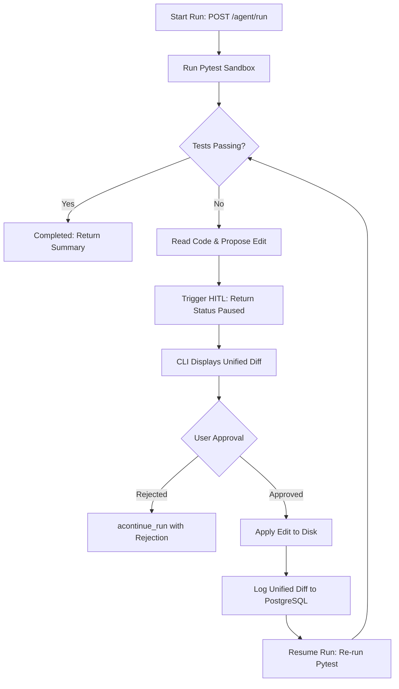
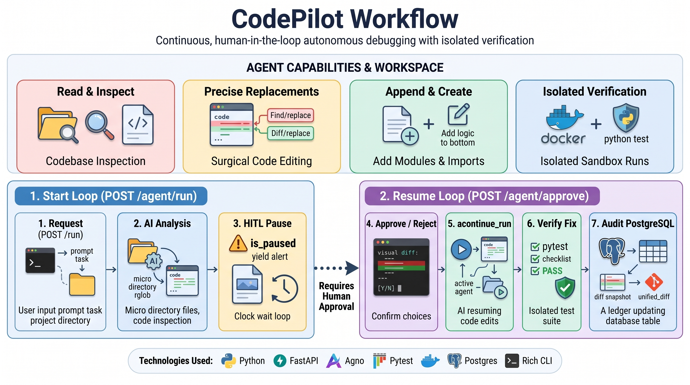
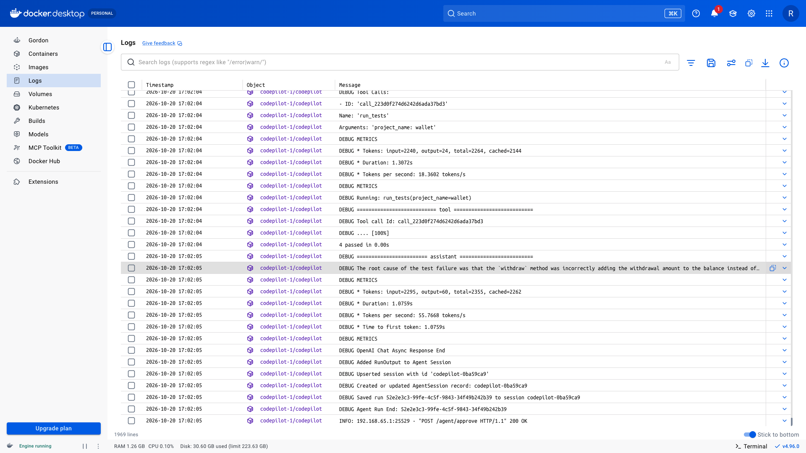

# CodePilot: Autonomous Debugging Agent

An autonomous software debugging engine that diagnoses failing test
suites, inspects codebases, proposes surgical file edits, and verifies
fixes in an isolated environment with Human-In-The-Loop (HITL) approval.

CodePilot executes tests inside an isolated container, navigates source
trees safely, and generates targeted unified diffs instead of rewriting
entire files. Destructive file operations pause execution, returning the
exact proposed change over HTTP for human confirmation. Approved edits
are written to disk, verified with another test run, and permanently
recorded in an immutable PostgreSQL audit ledger.

---

## Why this project

Autonomous code generation often fails in production because models
rewrite full files, introduce silent regressions, or hallucinate changes
without test feedback. A practical debugging agent needs guardrails,
deterministic file operations, human oversight, and verifiable test
feedback.

### This project enforces three strict boundaries:

1. **Surgical modifications over full rewrites:** The agent targets
   exact code snippets with character-for-character whitespace checks,
   preventing accidental deletions and broad rewrites.
2. **Stateless HTTP with stateful HITL:** Pausing and resuming runs
   is handled over standard REST endpoints without keeping sockets open
   or blocking the server event loop.
3. **Decoupled audit logging:** File modifications are logged as
   standard Git unified diffs directly into PostgreSQL, keeping audit
   history separate from the model's active reasoning scratchpad.

The result is a controlled debugging engine that fixes bugs safely,
verifies every change with pytest, and ensures no code touches the disk
without explicit human authorization.

---

## Skill Stack

<p align="left">


</p>

---

## What It Includes

### 1. Isolated test execution
Tests run inside a dedicated container sandbox. Test execution outputs
and failure traces are captured headlessly and returned to the agent
as the primary source of truth.

### 2. Path-traversal protection
All file operations pass through a directory boundary validator
(`safe_path`), preventing the agent from reading or writing files outside
the designated project workspace.

### 3. Surgical code editing
The `replace_code` tool requires exact string matches and verifies that
target snippets appear only once in the file. This blocks ambiguous edits
and preserves file formatting.

### 4. Human-in-the-loop approval
Modifying tools (`replace_code`, `append_code`, `create_file`) trigger
an execution pause. The server saves the paused coroutine state and
returns a `paused` status with the proposed arguments for human review.

### 5. PostgreSQL audit ledger
Every disk modification generates a unified diff using `difflib`. The
change, file name, timestamp, and technical reason are committed
directly to the `public.register_logs` database table.

### 6. Interactive terminal interface
A standalone Python CLI built with `rich` provides an interactive terminal
flow with animated status spinners, syntax-highlighted diff panels, and
inline confirmation prompts.

---

## Workflow



---

## Architecture



The workflow connects the user-facing CLI to the FastAPI backend,
isolates test execution within Docker, and preserves all verified diffs
inside PostgreSQL.

## Video Walkthrough

<video src="https://github.com/user-attachments/assets/995417c5-2fea-48cd-bd35-a635ab5a5ccd" controls="controls" width="100%"></video>

*View the 1-minute demo video showing failure
detection, interactive diff confirmation, and automated test resolution.*

## System Logs & Audit Trail



The service runs through Docker Compose, maintaining database migrations
with Alembic and persisting structured audit logs for every file change.

---

## Running the Project

### 1. Clone the repository

```bash
git clone https://github.com/imLeo007/codepilot.git
cd codepilot
```

### 2. Configure the environment

Create a `.env` file in the project root:

```env
DATABASE_URL=postgresql+asyncpg://postgres:password@db:5432/codepilot_db
AGNO_DATABASE_URL=postgresql+psycopg_async://postgres:password@db:5432/codepilot_db
OPENAI_API_KEY=your_api_key_here
```

### 3. Build and start the services

```bash
docker compose up -d --build
```

This starts the FastAPI server, the isolated test environment, and
PostgreSQL.

### 4. Run database migrations

```bash
docker compose exec codepilot alembic upgrade head
```

### 5. Launch the CLI interface

Run the interactive CLI on your host machine:

```bash
python cli.py
```

1. Select your target project (e.g., `calculator` or `wallet`).
2. Optionally inspect the recent PostgreSQL audit history.
3. Enter your debugging instruction (e.g., `"Fix all failing tests"`).
4. Review the syntax-highlighted diffs and approve or reject edits
   interactively.

---

## Final Note

CodePilot is built around verifiable actions rather than open-ended code
generation. By restricting the agent to surgical edits, validating every
step through automated tests, and requiring human approval before writing
to disk, it provides an autonomous debugging workflow that remains safe,
predictable, and fully auditable.